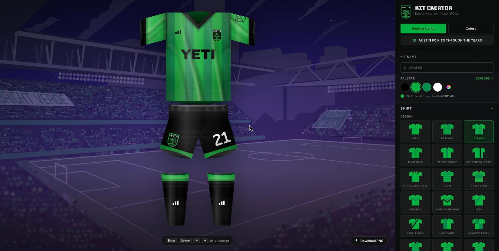
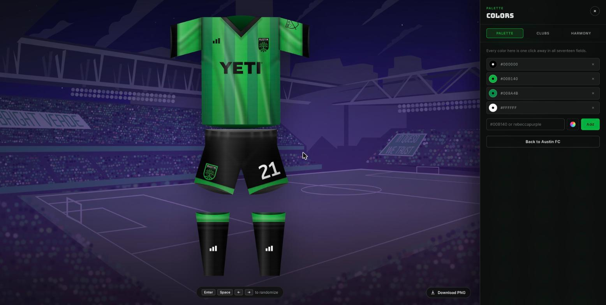
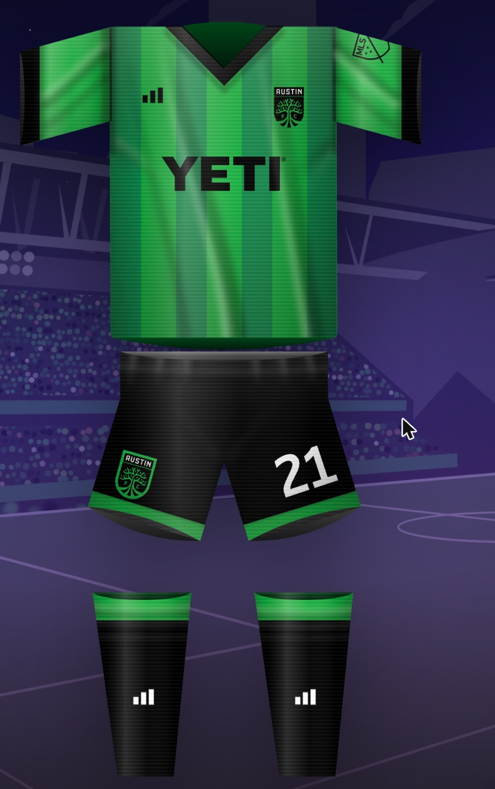

# AUSTIN FC KIT CREATOR

```
        ╔══════════════════════════════════════════════╗
        ║   I N S T R U C T I O N   B O O K L E T      ║
        ║                                              ║
        ║   1 PLAYER  ·  INFINITE CONTINUES            ║
        ║   BATTERY BACK-UP: YES, YOUR KIT IS SAVED    ║
        ╚══════════════════════════════════════════════╝
```

Do you have a sharp eye for design and a love of our city's great football
club? Pick colours, pick a pattern, and kit out eleven imaginary players. Or
mash the randomiser until something beautiful falls out. Either way — **LET'S
GROW THE LEGEND.**

### ▶ [PRESS START](https://austin-fc-kit-creator.netlify.app/)

---

## 1. YOUR SCREEN



The kit stands centre pitch. Every control lives in the panel on the right,
grouped into four drawers — **SHIRT**, **BADGE**, **SHORTS**, **SOCKS** — and
only one opens at a time, so you are never hunting through a wall of swatches.

**Click the kit itself** to paint a part with the colour currently selected in
the palette. Hover anything in the toolbar and the matching piece of the kit
lights up, so you always know what you are about to change.

---

## 2. CONTROLS

| Input | Action |
|---|---|
| `ENTER` / `SPACE` | Randomise the whole kit |
| `←` `→` | Randomise the whole kit |
| **Click the kit** | Paint that part with the selected colour |
| **FEELING LUCKY** | Randomise, with the reels spinning |
| **DOWNLOAD PNG** | Export at 1200×1600 on the stadium backdrop |
| Scroll / pinch on the kit | Zoom in |
| Drag a zoomed kit | Pan around |

---

## 3. SELECT YOUR LOADOUT

### Shirt — 22 designs

`solid` · `barcode` · `stripes` · `pinstripes` · `center stripe` ·
`off center stripe` · `shoulder stripes` · `hoops` · `chest band` · `chevron` ·
`double chevron` · `sash` · `double sash` · `half panel` · `quarter panel` ·
`checkered` · `tiger stripes` · `diagonal pinstripes` · `diagonal half` ·
`thirds` · `diamonds` · `fade`

Plus, separately coloured: primary, design, secondary, sleeves, cuffs, collar
(**V-neck** or **button**), the chest wordmark and its outline, and the brand
mark.

### Badge

Worn twice, on the shirt and on the shorts, and coloured separately in each
place. Choose the traced **crest** or the tree **roundel**; the roundel on the
shirt can sit on a filled **disc** or print straight onto the cloth.

### Shorts

Primary, trim, optional **side panels**, squad number — each its own colour.

### Socks

Primary, tops, optional **hoops**, and a printed ankle mark that can be your
own **text** or the **tree**.

### The stadium behind it

Six skies: `sunset` · `summer night` · `dawn` · `verde` · `ember` · `twilight`.
Summer night gets stars.

---

## 4. THE PALETTE



Every colour in the palette is one click away in all seventeen fields, so a kit
is built from a small set of colours rather than seventeen unrelated choices.

- **PALETTE** — add any hex or CSS colour name. `rebeccapurple` works.
- **CLUBS** — 87 club palettes to borrow from, or swap to wholesale.
- **HARMONY** — complements, triads and analogous sets built off any colour.

**AUSTIN FC KITS THROUGH THE YEARS** loads real kits the club has worn, as
starting points you can edit.

---

## 5. STRATEGY

> *Notes from the development team, for players who like to know how the
> machine works.*

**The picture you save is the picture you saw.** The PNG is not a second
drawing of the kit — the exporter reads the live SVG off the page, so the file
and the screen cannot disagree. Everything else follows from protecting that.
The kit is frozen before capture, because a shot taken mid-animation bakes in a
half-finished colour. Numbers that both the screen and the canvas need — the
sky gradients, the star positions — are defined exactly once.

**Measure, don't guess.** Most of the real bugs here have been visual or
timing-related, and several were only caught by measuring the running page. A
drop-shadow on all 96 floodlights halved the frame rate, 28fps against 61, so
only one bulb in four carries one now. The pan clamp once ran away to five
figures by reading back a rectangle that had not re-rendered yet. Every shading
change is checked by diffing two exports, because an effect that renders on
screen and vanishes from the file is the easiest mistake in this codebase to
make.

**Nothing on the kit is allowed to become unreadable.** A table says what sits
on what — sponsor on shirt, number on shorts, hoops on socks — and the
randomiser repairs any pairing that falls below a contrast floor. When the
palette genuinely cannot make something read, it reaches for an outline instead
of a colour. Direct edits are left alone on purpose: someone choosing a
specific colour for a specific part has said what they want.

**The kit is flat art pretending to have a body.** It is lit from the upper
left, hung with folds that lean together as though air were moving across it,
creased at every seam where two pieces of cloth meet, and opened at the neck,
the cuffs, the hem and both legs so you can see the far side of the garment
through them. A fold is a highlight paired with a shadow, never a stripe. A
tube's far wall pinches to nothing where it meets the near one. The back of a
shirt hangs below its front.



**Three tables drive most of the behaviour**, and adding a colour means
touching all three: which colour paints which part, its inverse for
click-to-paint, and what sits on what for the contrast guards. Extending a
table beats adding another branch to a chain of `if`s — the legibility guards
were five hand-ordered comparisons that could undo one another before they
became a table.

---

## 6. SHARING

Hit **DOWNLOAD PNG** for a 1200×1600 image on the stadium backdrop, signed
along the foot, then post it with **#AustinFCKitCreator**.

Kits you save go to a gallery, and each one has its own link you can send to
somebody.

---

## 7. FOR DEVELOPERS

Vue 3 + Vite, one component tree, no router, no store. Requires Node 20.19+ or
22.12+.

```
npm install        # set up
npm run dev        # dev server on port 8080, hot reload
npm run build      # production build
npm run preview    # preview that build
npm run lint       # eslint
npm run test:colors # the colour maths in lib/colorTools.js
```

There is no test framework. `src/lib/colorTools.test.mjs` is a dependency-free
script that runs under plain node and exits non-zero on failure — the colour
maths is the one part of this project pure enough to check that way. Everything
else is verified by running the app and driving it in a browser.

See [`CLAUDE.md`](CLAUDE.md) for the traps that will cost you an afternoon.

Configuration: the [Vite config reference](https://vite.dev/config/).
